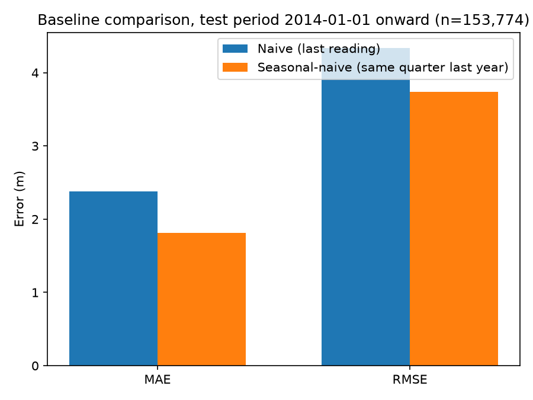

# Baseline Forecast Results

Time-based backtest: trained on data before 2014-01-01, evaluated on 2014-01-01 onward (153,774 test readings where both baselines have a valid prediction, so the comparison is apples-to-apples). No model fitting involved -- both baselines are simple rules applied directly.

## Overall

| Baseline | MAE (m) | RMSE (m) |
|---|---|---|
| Naive (predict = last reading) | 2.376 | 4.335 |
| Seasonal-naive (predict = same quarter last year) | 1.809 | 3.742 |

**Result: seasonal-naive beats naive by 23.8% on MAE.** This confirms, with real backtested numbers, what the seasonality EDA finding predicted: because the seasonal swing is larger than the underlying trend, comparing a well to itself one year back is a meaningfully better default than comparing it to its own last quarter.

## By season

Mean absolute error broken down by which quarter is being predicted:

| Season | Naive MAE (m) | Seasonal-naive MAE (m) |
|---|---|---|
| Aug | 3.164 | 1.829 |
| Jan | 2.049 | 1.735 |
| May | 2.558 | 1.971 |
| Nov | 1.739 | 1.702 |

The naive baseline is worst exactly at the seasonal turning points (transitioning into or out of monsoon), where consecutive readings differ the most -- consistent with the seasonality finding.

## By worst-declining district (from DATA_AUDIT.md)

| State | District | Naive MAE (m) | Seasonal-naive MAE (m) | Winner | n |
|---|---|---|---|---|---|
| HR | Kurukshetra | 2.757 | 2.474 | seasonal-naive | 119 |
| RJ | Sikar | 2.267 | 2.463 | naive | 318 |
| RJ | Dausa | 2.823 | 3.541 | naive | 143 |
| RJ | Jhunjhunun | 2.195 | 2.626 | naive | 166 |
| PB | Sangrur | 1.539 | 1.766 | naive | 147 |
| HR | Gurgaon | 1.439 | 1.458 | naive | 53 |
| GJ | Banas Kantha | 4.688 | 5.501 | naive | 493 |
| PB | Barnala | 1.783 | 1.263 | seasonal-naive | 71 |
| RJ | Jaipur | 2.567 | 3.202 | naive | 375 |
| RJ | Alwar | 2.428 | 2.651 | naive | 319 |

**The pattern reverses here: in 8/10 of the fastest-declining districts, plain naive beats seasonal-naive** -- the opposite of the national result above. The reason is consistent with what these districts are: they have a strong ongoing multi-year decline (that's *why* they're on this list), so 'same quarter last year' is off by a full year of depletion, while 'last quarter' is only 3 months stale. In other words, in a stable district the seasonal cycle dominates the error and seasonal-naive wins; in a fast-declining district the trend dominates and naive wins. Neither simple baseline handles both effects at once -- that gap (needing to model season *and* trend together) is exactly what the next modelling stage needs to close, and it's the strongest argument in this project for why a real model is needed rather than a lookup rule.

## What this sets up

Seasonal-naive (MAE 1.809 m) is the bar any real model must clear. A model that can't beat this isn't worth deploying, however sophisticated it is.
