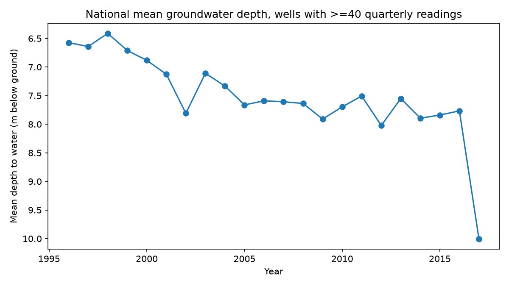
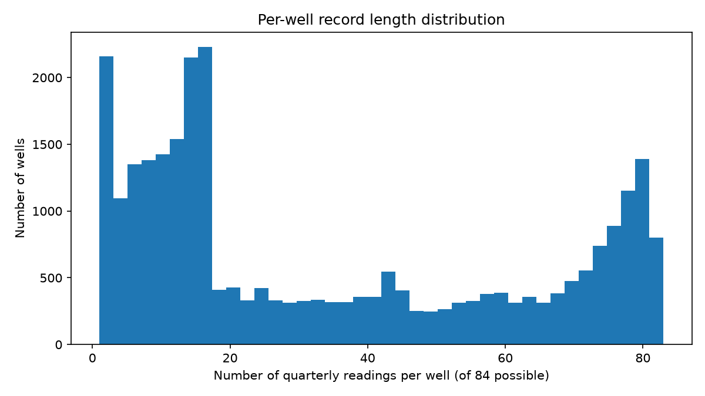

# Data Audit

Generated by `src/eda/data_audit.py` against the cleaned CGWB dataset. Numbers below are computed from the actual data, not estimated.

## Coverage

- Wells: 28,072
- States: 24
- Districts: 525
- Total well-quarter readings: 963,072
- Wells with >=20 readings: 14,334 (51.1%)
- Wells with >=40 readings: 10,858 (38.7%)

## National mean depth-to-water trend (wells with >=40 readings)

| Year | Mean depth (m) | Median depth (m) | # readings |
|---|---|---|---|
| 1996 | 6.57 | 4.90 | 25132 |
| 1997 | 6.64 | 5.00 | 33858 |
| 1998 | 6.41 | 4.64 | 33900 |
| 1999 | 6.71 | 4.78 | 34215 |
| 2000 | 6.88 | 4.95 | 35678 |
| 2001 | 7.13 | 5.10 | 36321 |
| 2002 | 7.81 | 5.78 | 35036 |
| 2003 | 7.11 | 5.34 | 34319 |
| 2004 | 7.33 | 5.60 | 32911 |
| 2005 | 7.66 | 5.42 | 38039 |
| 2006 | 7.59 | 5.30 | 39095 |
| 2007 | 7.61 | 5.27 | 39150 |
| 2008 | 7.64 | 5.31 | 38341 |
| 2009 | 7.91 | 5.55 | 37149 |
| 2010 | 7.70 | 5.30 | 36128 |
| 2011 | 7.51 | 5.03 | 35893 |
| 2012 | 8.02 | 5.61 | 26469 |
| 2013 | 7.55 | 5.00 | 33909 |
| 2014 | 7.89 | 5.38 | 32292 |
| 2015 | 7.84 | 5.32 | 33259 |
| 2016 | 7.77 | 5.25 | 30275 |
| 2017 | 10.00 | 8.29 | 940 | *(partial year — see note)*

*Note: 1996 and 2017 are partial years in the source data (readings start May 1996 and stop Jan 2017), so their averages are drawn from a much smaller, non-comparable sample and should be read with caution rather than as real endpoints of the trend.*

## Per-well record length

## Districts with the steepest declining trend (deepening water table)

Simple linear fit per district, m/year, restricted to districts with >=5 wells that each have >=20 readings. This is a sanity check, not the project's final model.

| State | District | Slope (m/year) | # wells |
|---|---|---|---|
| HR | Kurukshetra | 1.192 | 13 |
| RJ | Sikar | 1.076 | 42 |
| RJ | Dausa | 1.065 | 31 |
| RJ | Jhunjhunun | 1.033 | 24 |
| PB | Sangrur | 1.026 | 12 |
| HR | Gurgaon | 1.012 | 15 |
| GJ | Banas Kantha | 1.011 | 44 |
| PB | Barnala | 0.969 | 8 |
| RJ | Jaipur | 0.911 | 74 |
| RJ | Alwar | 0.772 | 47 |
