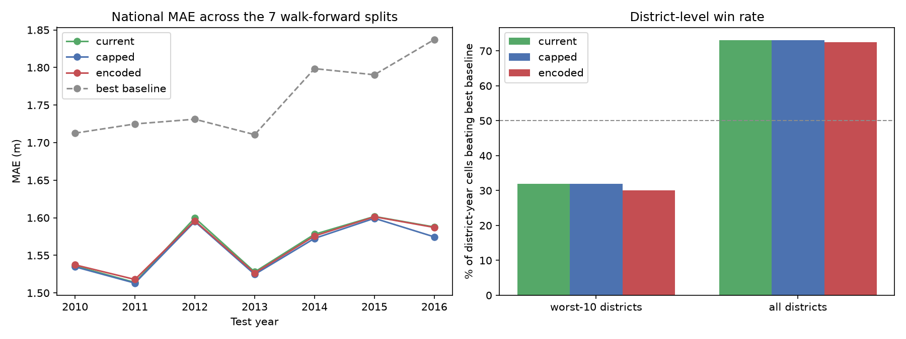

# Does giving the model `district` close the district-level gap?

`docs/EVALUATION.md` leaves one result open: gradient boosting wins 7/7 national splits but only about a third of the district-year checks in the fastest-declining districts. `district` was excluded from the model because 525 one-hot columns would invite overfitting -- true for Ridge, but the gradient-boosted model never one-hot encodes anything, so the exclusion was never tested for the model that actually ships. This tests it, on the same 7 walk-forward splits, same features, same seed.

| Arm | How district reaches the model |
|---|---|
| `current` | it does not -- the shipped model |
| `capped` | native categorical, rarest districts folded into one OTHER bucket (HistGradientBoosting caps a categorical at 255 values) |
| `encoded` | one numeric column from sklearn's `TargetEncoder`, cross-fitted on train |

## National MAE by split

| Test year | Test n | Best baseline | current | capped | encoded |
|---|---|---|---|---|---|
| 2010 | 37,462 | 1.713 | 1.536 | 1.535 | 1.537 |
| 2011 | 35,826 | 1.725 | 1.514 | 1.513 | 1.518 |
| 2012 | 26,955 | 1.731 | 1.600 | 1.595 | 1.596 |
| 2013 | 28,013 | 1.711 | 1.528 | 1.525 | 1.527 |
| 2014 | 43,718 | 1.798 | 1.578 | 1.573 | 1.576 |
| 2015 | 51,293 | 1.790 | 1.602 | 1.599 | 1.601 |
| 2016 | 52,494 | 1.837 | 1.588 | 1.575 | 1.587 |
| **mean** | | | **1.564** | **1.559** | **1.563** |

## District-level win rate (vs. the better naive baseline)

| Arm | Fastest-declining 10 | All districts |
|---|---|---|
| `current` | 16/50 (32%) | 1891/2587 (73%) |
| `capped` | 16/50 (32%) | 1889/2587 (73%) |
| `encoded` | 15/50 (30%) | 1875/2587 (72%) |

The all-districts column is the more trustworthy of the two: the worst-10 column rests on only 50 district-year cells, where a single cell moves the rate by 2%, while the all-districts column rests on 2,587. The worst-10 number is the one quoted in `docs/EVALUATION.md`, so it is kept here for continuity, not because it is the better measurement.

## Head to head against the shipped model

Beating a naive rule and beating the model this project already ships are different questions. Per district-year cell, how often does each arm beat `current`?

| Arm | Fastest-declining 10 | All districts |
|---|---|---|
| `capped` | 34/50 (68%) | 1327/2587 (51%) |
| `encoded` | 24/50 (48%) | 1289/2587 (50%) |

## Verdict

**`capped` has the lowest mean national MAE** (1.559m vs 1.564m for the shipped model, +0.3%). It is ahead in 7/7 individual splits, so the direction is consistent rather than a single lucky cut -- but the size of it is not something a user of this system would ever notice. And in the fastest-declining districts -- the gap this experiment set out to close -- no arm does better than what already ships (16/50 (32%) either way). **The gap is not a missing-district-identity problem.**

### The limitation is narrower than this project has been describing it

Measured across **all** districts rather than the worst 10, the shipped model beats the better naive baseline in 1891/2587 (73%) of district-year cells -- not the 32% that `docs/EVALUATION.md` quotes. Both numbers are real and they are not in conflict: they are different populations. The model is not weak at district level in general; it is weak *specifically* in districts whose water table is falling fastest, which is 41% worse than its own typical district. That is a sharper and more useful statement of the limitation than the one this project started with, and it is worth being precise about, because the broad version understates the model and the narrow version is the one that actually threatens the use case.

### District identity does help in those districts -- just not enough

Head to head, `capped` beats `current` in 34/50 (68%) of the worst-10 cells while its win rate against the baseline stays at 16/50 (32%). So knowing the district does reduce error there; it just does not reduce it far enough to cross the bar a naive rule already clears. Whatever the fast-declining districts need, a per-district intercept is not it.

### What was decided

**The shipped model is left unchanged.** A 0.28% national gain that does nothing for the limitation it was meant to address does not justify adding a 255-category feature, an OTHER bucket whose membership shifts every time the model is retrained, and a regeneration of every downstream stage. The experiment is kept because the answer is useful -- it rules out the obvious explanation and redirects the next attempt, most plausibly toward an uncertainty estimate that tells a user when to distrust a district's forecast rather than toward trying to make the point forecast better.
