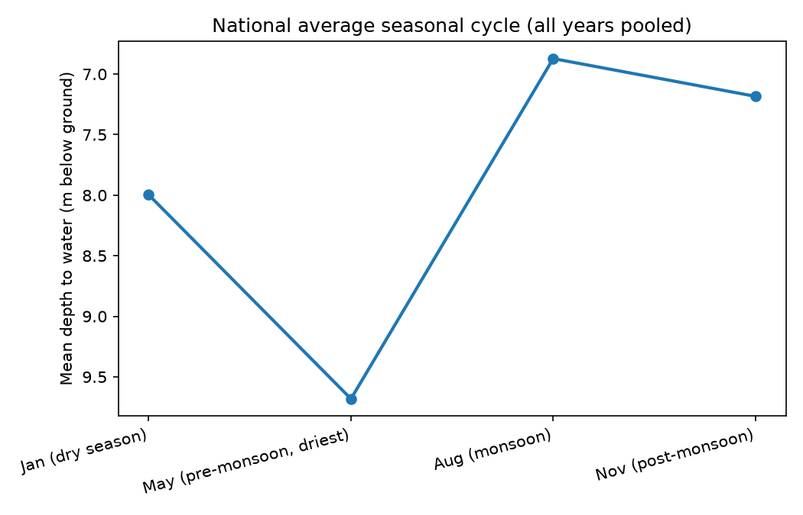
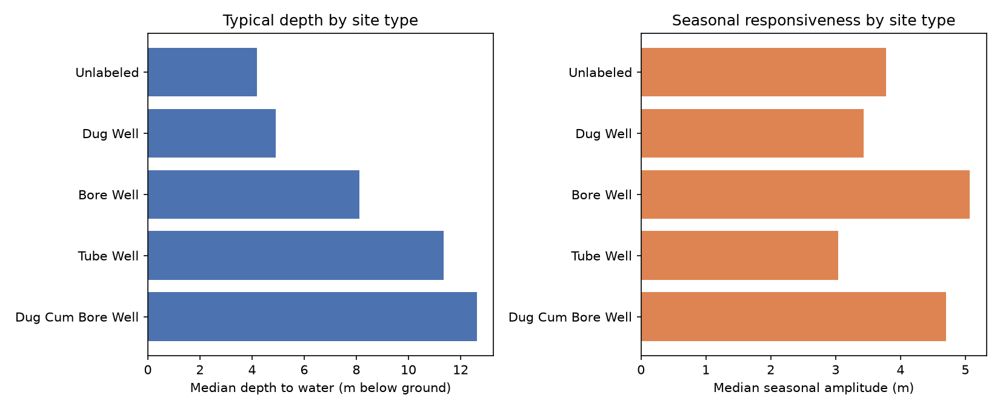
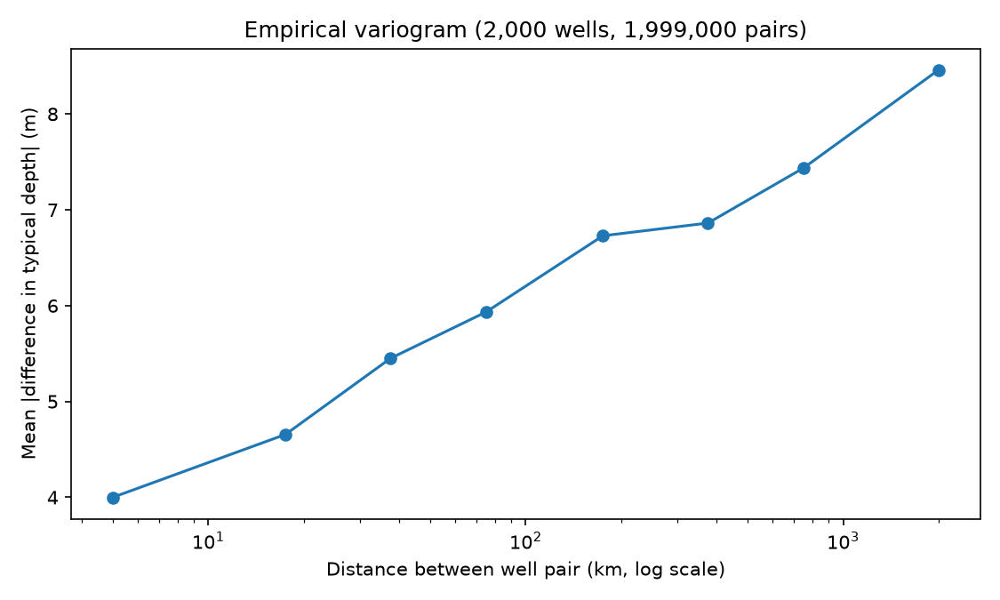

# EDA Findings

Deeper exploratory analysis beyond the initial data audit. Each section is a real, computed finding with a stated implication for modelling -- not decoration.

## Seasonality

Mean depth-to-water by measurement quarter, pooled across all years and wells:

| Quarter | Mean depth (m) |
|---|---|
| Jan (dry season) | 8.00 |
| May (pre-monsoon, driest) | 9.68 |
| Aug (monsoon) | 6.87 |
| Nov (post-monsoon) | 7.18 |

The water table is on average **2.81 m shallower in August than in May** -- i.e. the monsoon visibly recharges groundwater nationally, and it draws back down through the dry season until the next monsoon. This is the expected physical pattern, which is itself a sanity check that the data is measuring something real.

**Per-well seasonal swing:** using only well-years with all 4 quarters present (158,187 well-years), the typical (median) swing between a well's deepest and shallowest reading in the same year is **3.52 m** (90th percentile: 8.41 m).

**Modelling implication:** the seasonal swing is comparable in size to, or larger than, the multi-year depletion trend found in `DATA_AUDIT.md` (roughly 1 m/year in the fastest-declining districts). A model that ignores season would likely mistake normal pre-monsoon dips for depletion, or mask real depletion behind a good monsoon year. Any forecasting model built later must condition on quarter/season, and any trend estimate should compare same-quarter readings across years rather than raw consecutive readings.

## Site-type effects

CGWB well readings come from physically different well types. Categories with fewer than 500 readings are excluded below as too small to say anything reliable about.

| Site type | # wells | # readings | Mean depth (m) | Median depth (m) | Std dev (m) | Median seasonal swing (m) |
|---|---|---|---|---|---|---|
| Unlabeled | 581 | 17,904 | 5.71 | 4.18 | 7.72 | 3.78 |
| Dug Well | 19,671 | 771,125 | 6.53 | 4.92 | 6.81 | 3.43 |
| Bore Well | 3,975 | 97,297 | 10.71 | 8.12 | 9.52 | 5.07 |
| Tube Well | 3,799 | 75,172 | 19.22 | 11.35 | 22.09 | 3.04 |
| Dug Cum Bore Well | 44 | 1,529 | 14.58 | 12.62 | 9.68 | 4.70 |

**Findings:** dug wells (the large majority of the network, ~77% of readings) are shallow and relatively low-variance -- they track the near-surface water table closely. Bore and tube wells are markedly deeper, far noisier (tube wells have roughly 3x the standard deviation of dug wells), and swing more with the season, consistent with them tapping deeper, more heterogeneous aquifer layers rather than the shallow water table.

**Modelling implication:** site type is a real confound, not just metadata -- it should be included as a feature (or used to fit separate models per type) rather than pooling all wells together, since a 'depth of 15m' means something different for a dug well (unusually deep, possibly concerning) than for a tube well (unremarkable). The high variance in tube wells also means their readings need more caution before being used to flag anomalies -- a single-well spike is far more likely to be normal noise there.

## Spatial patterns

Empirical variogram: for 2,000 randomly sampled wells (all with >=20 readings), every pairwise distance and the absolute difference in each well's average depth-to-water, binned by distance.

| Distance range | Mean |depth difference| (m) | # pairs |
|---|---|---|
| 0-10 km | 4.00 | 330 |
| 10-25 km | 4.66 | 1,698 |
| 25-50 km | 5.45 | 5,131 |
| 50-100 km | 5.93 | 17,640 |
| 100-250 km | 6.73 | 99,459 |
| 250-500 km | 6.86 | 263,611 |
| 500-1000 km | 7.44 | 647,596 |
| 1000-3000 km | 8.46 | 963,535 |

**Finding:** wells within 10 km of each other differ in typical depth by 4.00 m on average, versus 8.46 m for wells over 1000 km apart -- a 2.1x difference. This is a clear, real spatial autocorrelation signal: nearby wells are systematically more similar than distant ones, consistent with them sharing the same local aquifer/soil geology, not random noise.

**Modelling implication:** this justifies using spatial structure explicitly later -- e.g. a district- or neighbor-averaged feature, or spatial interpolation (kriging) to estimate conditions in gaps between monitoring wells -- rather than treating each well as an independent, unrelated time series. It also means a well with very few readings can reasonably borrow information from its geographic neighbors, which matters given how many wells in this dataset have short records (see `DATA_AUDIT.md`).
