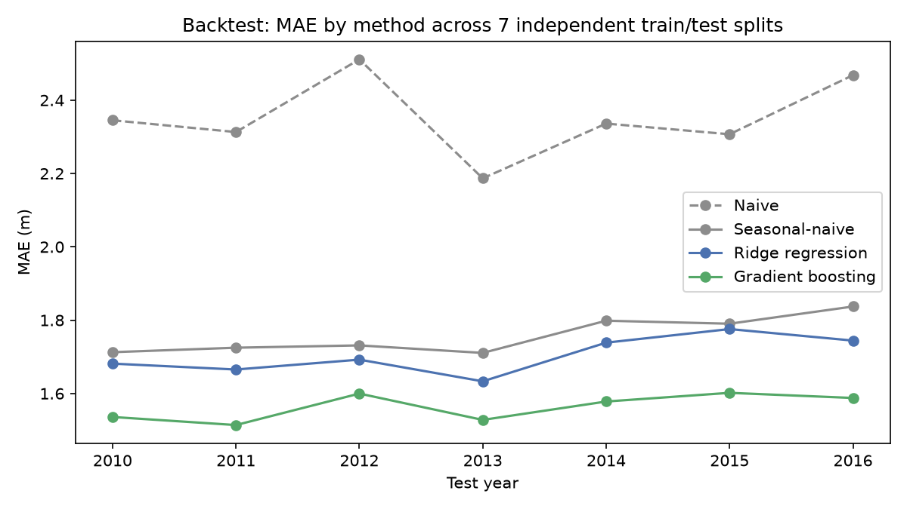

# Evaluation: Multi-Split Backtest

`docs/ML_MODEL_RESULTS.md` tested one train/test split. This repeats the same comparison across 7 independent walk-forward splits (test = one full year, trained on everything strictly before it) to check whether that single result was representative or just what one particular split happened to show.

## Results by split

| Test year | Train n | Test n | Naive MAE | Seasonal-naive MAE | Ridge MAE | GBM MAE | GBM vs best baseline |
|---|---|---|---|---|---|---|---|
| 2010 | 606,950 | 37,462 | 2.345 | 1.713 | 1.681 | 1.536 | +10.3% |
| 2011 | 648,668 | 35,826 | 2.313 | 1.725 | 1.665 | 1.514 | +12.2% |
| 2012 | 689,733 | 26,955 | 2.511 | 1.731 | 1.692 | 1.600 | +7.6% |
| 2013 | 722,770 | 28,013 | 2.187 | 1.711 | 1.633 | 1.528 | +10.7% |
| 2014 | 774,680 | 43,718 | 2.336 | 1.798 | 1.739 | 1.578 | +12.3% |
| 2015 | 832,734 | 51,293 | 2.307 | 1.790 | 1.776 | 1.602 | +10.5% |
| 2016 | 896,673 | 52,494 | 2.468 | 1.837 | 1.744 | 1.588 | +13.6% |

## Is gradient boosting's national win consistent?

**Gradient boosting beats the best baseline in 7/7 splits**, with a mean improvement of +11.0% (std dev 1.9 percentage points across splits). It wins in every single split tested -- the single-split result in ML_MODEL_RESULTS.md was not a fluke; this is a consistent, real improvement over the baselines.

## Is the fastest-declining-district gap consistent?

Across all splits, gradient boosting beat the best baseline in **16/50** individual (district, year) checks with at least 30 test readings (fewer checks than districts x splits, since many district-years fall below that threshold and are excluded as too small to trust). That's a 32% win rate in exactly the districts that matter most for an early-warning use case. This confirms, rather than resolves, the concern raised in ML_MODEL_RESULTS.md: the model's district-level performance in the highest-priority areas is genuinely weaker and less reliable than its strong national average suggests. Before any real early-warning output is built on this model, it needs either district-specific tuning, more training data per district, or an explicit uncertainty estimate so a user knows when to trust a given district's forecast less.

## Is it weak at district level generally, or only in those ten?

The number above on its own is easy to over-read. Run the identical check over **every** district rather than the fastest-declining ten, and gradient boosting beats the best baseline in **1,891/2,587** (district, year) cells -- a 73% win rate, against 32% in those ten. Both numbers are real and they do not contradict each other; they are different populations. The model is not weak at district level in general. It is weak *specifically* where the water table is falling fastest, winning about 41 percentage points less often there than in a typical district. That is the precise form of the limitation, and the precise form matters: the broad reading understates a model that is usually right, while the narrow reading is the one that actually threatens the use case, because those are exactly the districts this system exists to flag.

`docs/DISTRICT_MODEL.md` follows this up by testing the most obvious explanation -- that the model simply isn't told which district a well is in -- and rules it out.

## Honest conclusion

Gradient boosting is a genuine, backtested improvement over both simple baselines nationally (+11.0% average across 7 independent splits), and it holds up across districts in general (73% of all district-year cells). Its advantage in the specific districts an early-warning system cares about most is the exception (32% win rate), and should be treated as an open limitation, not a solved problem, going into the explainability and actionable-output stages.
