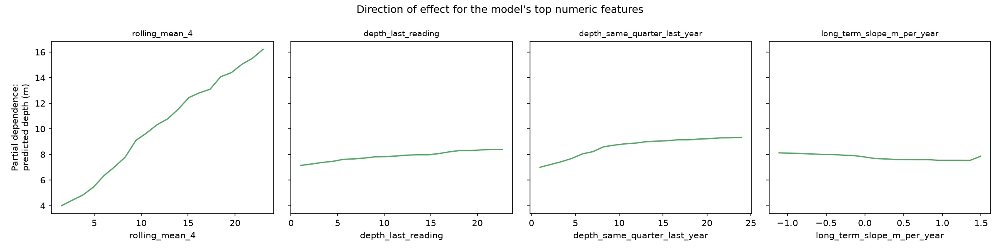

# Explainability

**Methodology note:** this stage hit the same underlying problem twice. First, SHAP TreeExplainer produced per-feature attributions that contradicted permutation importance computed on the identical model (SHAP ranked `n_prior_readings` far above everything else; permutation importance -- on the same model -- ranked it near the bottom, matching the officially reported model). Then, scikit-learn's default (`recursion`) partial-dependence method returned a completely flat curve -- zero variation -- for 3 of the 4 top features, which is impossible given their permutation importance. Both tools' fast paths rely on walking this model's internal tree structure directly, and both mishandle its native categorical splits for this scikit-learn/estimator combination -- a real library compatibility gap, not a property of the model. Both were caught by cross-checking against a method that instead calls `.predict()` on real, modified rows -- permutation importance for magnitude, and partial dependence with `method="brute"` for direction -- which is slower but doesn't depend on that internal traversal, so it isn't exposed to the bug. Recording this because catching a broken explanation before publishing it, twice, is part of doing this honestly.

## What drives the model's predictions (global)

| Feature | Permutation importance (MAE increase, m) |
|---|---|
| `rolling_mean_4` | 3.311 |
| `depth_same_quarter_last_year` | 0.381 |
| `depth_last_reading` | 0.284 |
| `season` | 0.199 |
| `neighbor_mean_depth` | 0.160 |
| `state` | 0.096 |
| `long_term_slope_m_per_year` | 0.053 |
| `n_prior_readings` | 0.037 |
| `lat` | 0.016 |
| `lon` | 0.013 |
| `site_type` | 0.007 |

Consistent with `docs/ML_MODEL_RESULTS.md`: recent readings (`rolling_mean_4`, `depth_last_reading`) and the seasonal comparison (`depth_same_quarter_last_year`) dominate.

## Which direction does each feature push the prediction?

Three curves rise clearly and monotonically, as expected: a well with a higher recent, rolling-average, or same-season-last-year reading gets predicted deeper too -- the physically sensible direction. `long_term_slope_m_per_year`, though, is nearly flat -- holding a well's recent absolute readings fixed, knowing its explicit multi-year trend barely moves the prediction. That's not a bug (permutation importance already showed this feature ranks 7th of 11, well below the recent-reading features), but it is a substantive finding: the model gets almost all of its depletion signal implicitly, from recent absolute readings, rather than explicitly extrapolating the trend feature forward. That is directly consistent with the district-level bias below -- a model that barely leans on trend on its own has little basis to extrapolate *further* than recent readings already imply, which is exactly where it falls short in the fastest-declining districts.

## Why does it struggle in the fastest-declining districts?

National mean error (actual - predicted): **+0.244m**. Per fastest-declining district:

| State | District | Mean error (actual - predicted) | MAE | n |
|---|---|---|---|---|
| RJ | Dausa | +0.795 | 2.675 | 143 |
| GJ | Banas Kantha | +0.750 | 7.021 | 493 |
| PB | Barnala | +0.287 | 1.193 | 71 |
| HR | Gurgaon | +0.237 | 1.469 | 53 |
| PB | Sangrur | +0.229 | 1.253 | 147 |
| HR | Kurukshetra | +0.194 | 2.347 | 119 |
| RJ | Jhunjhunun | -0.245 | 3.308 | 166 |
| RJ | Jaipur | -0.248 | 2.925 | 375 |
| RJ | Alwar | -0.340 | 2.367 | 319 |
| RJ | Sikar | -0.387 | 3.228 | 318 |

**6/10 of these districts have a positive mean error** -- actual depth is greater than predicted, i.e. the model is systematically *too optimistic* in most of the districts that matter most: it under-predicts how deep the water table actually gets, the wrong direction of error for an early-warning system (better to overstate severity than miss a genuine worsening). Consistent with a model trained mostly on the national mix of stable/slowly-changing wells regressing fast-decliners toward typical behavior rather than fully extrapolating their unusually steep local trend.

## A concrete example (local explainability)

The largest under-prediction *within the fastest-declining districts*: a well in **Banas Kantha, GJ**, actual depth 106.40m, predicted 21.83m (model was 84.57m too shallow). For context, this well's own feature values versus its 492 district peers in the test set:

| Feature | This well | District median (other wells) |
|---|---|---|
| `depth_last_reading` | 19.00 | 22.30 |
| `rolling_mean_4` | 22.27 | 22.54 |
| `depth_same_quarter_last_year` | 23.46 | 22.73 |
| `long_term_slope_m_per_year` | 3.10 | -0.03 |

The recent readings (`depth_last_reading`, `rolling_mean_4`) are unremarkable -- close to or even shallower than this well's district peers, nothing there would flag concern. But `long_term_slope_m_per_year` (3.10 m/year) is dramatically steeper than the district's typical well (-0.03, essentially flat). This is exactly the scenario the partial-dependence finding above predicts will go wrong: the model barely uses the trend feature on its own (the nearly-flat slope curve), so a well whose only warning sign is a steep trend -- with otherwise ordinary recent readings -- is precisely the case it's least equipped to catch. The actual outcome (106.40m) validates that the trend signal was real; the model's under-reliance on it is a plausible, specific explanation for missing it this badly, and points to a concrete fix: give the trend feature more weight, or add a feature that flags an accelerating (not just nonzero) trend specifically.

## What this means for the project

This explains, rather than just flags, the district-level gap found in `docs/EVALUATION.md`: the model isn't randomly worse there, it has a specific, measurable bias -- under-predicting depth in most fast-declining districts. That's a concrete, actionable direction for future work (an acceleration feature), and an important honest caveat for the actionable-output stage: any risk score built on this model should treat its output as a *lower bound* on severity in these districts, not a point estimate.
