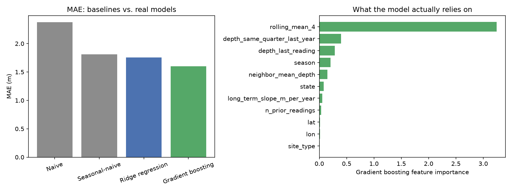

# ML Model Results

Same time-based split and same test rows as `docs/BASELINE_RESULTS.md` (train before 2014-01-01, test on/after, 153,774 test readings), so every number below is directly comparable to the baseline table.

Features used: depth_last_reading, depth_same_quarter_last_year, rolling_mean_4, long_term_slope_m_per_year, neighbor_mean_depth, n_prior_readings, lat, lon (numeric) and season, site_type, state (categorical). `district` (525 categories) was deliberately left out -- `state` + `lat`/`lon` + `neighbor_mean_depth` already carry geographic signal at a coarser and a finer grain, and including 525 near-unique one-hot columns risked the linear model overfitting to individual districts rather than learning general spatial structure.

## Results

| Method | MAE (m) | RMSE (m) |
|---|---|---|
| Naive (baseline) | 2.376 | -- |
| Seasonal-naive (baseline) | 1.809 | -- |
| Ridge regression | 1.758 | 3.171 |
| Gradient boosting | 1.600 | 3.250 |

**Gradient boosting beats the best baseline (seasonal-naive) by 11.5% on MAE.** Ridge regression also beats it, by 2.8%.

## What the model actually relies on (gradient boosting feature importance)

| Feature | Importance |
|---|---|
| `rolling_mean_4` | 3.247 |
| `depth_same_quarter_last_year` | 0.396 |
| `depth_last_reading` | 0.281 |
| `season` | 0.203 |
| `neighbor_mean_depth` | 0.149 |
| `state` | 0.082 |
| `long_term_slope_m_per_year` | 0.056 |
| `n_prior_readings` | 0.031 |
| `lat` | 0.014 |
| `lon` | 0.011 |
| `site_type` | 0.007 |

Importance = how much MAE gets worse when that column is randomly shuffled (bigger = more relied on). This is a first look using scikit-learn's permutation importance, not the formal explainability stage still to come in the pipeline (which goes further -- see docs/EXPLAINABILITY.md, which also documents why SHAP's TreeExplainer turned out to be unusable for this particular model) -- but it already confirms the model leans on sensible signals (recent readings and trend dominate) rather than something spurious.

## Does it close the gap in the fastest-declining districts?

`docs/BASELINE_RESULTS.md` found that in 8/10 of the fastest-declining districts, neither simple baseline was reliable (naive and seasonal-naive traded wins depending on whether trend or season dominated there). Checking the same districts here, against whichever baseline was actually best in each one:

| State | District | Best baseline MAE (m) | Ridge MAE (m) | Gradient boosting MAE (m) | GBM beats baseline? | n |
|---|---|---|---|---|---|---|
| HR | Kurukshetra | 2.474 | 3.044 | 2.347 | yes | 119 |
| RJ | Sikar | 2.267 | 3.253 | 3.228 | no | 318 |
| RJ | Dausa | 2.823 | 2.985 | 2.675 | yes | 143 |
| RJ | Jhunjhunun | 2.195 | 2.834 | 3.308 | no | 166 |
| PB | Sangrur | 1.539 | 2.046 | 1.253 | yes | 147 |
| HR | Gurgaon | 1.439 | 2.161 | 1.469 | no | 53 |
| GJ | Banas Kantha | 4.688 | 5.175 | 7.021 | no | 493 |
| PB | Barnala | 1.263 | 1.927 | 1.193 | yes | 71 |
| RJ | Jaipur | 2.567 | 3.176 | 2.925 | no | 375 |
| RJ | Alwar | 2.428 | 2.481 | 2.367 | yes | 319 |

**Gradient boosting beats the best available baseline in 5/10 of these districts.** It doesn't win everywhere, which is worth being honest about: 5 district(s) still aren't clearly improved. Small per-district sample sizes (n column above) make these individual numbers noisier than the overall test-set result, so this is a directional check, not a guarantee -- worth a closer look in the evaluation stage rather than treated as settled here.

## What this means for the project

Two results, both real, that don't fully agree: gradient boosting beats the best baseline by a solid 11.5% nationally, but only wins outright in 5/10 of the specific fastest-declining districts that matter most for an early-warning system. The likely reason is sample size -- each district has only a few hundred test readings at most (see the `n` column above) versus ~154k nationally, so the model has far less signal to learn a district's specific behavior from, and a single national model may be under-fitting these harder, faster-moving districts even while it does well on average. That gap -- not the headline national number -- is the honest state of this stage, and it's exactly what the evaluation/backtesting stage needs to characterize properly (e.g. is it consistent across other time splits, or noise from small samples?) before any claim about district-level usefulness is made.
