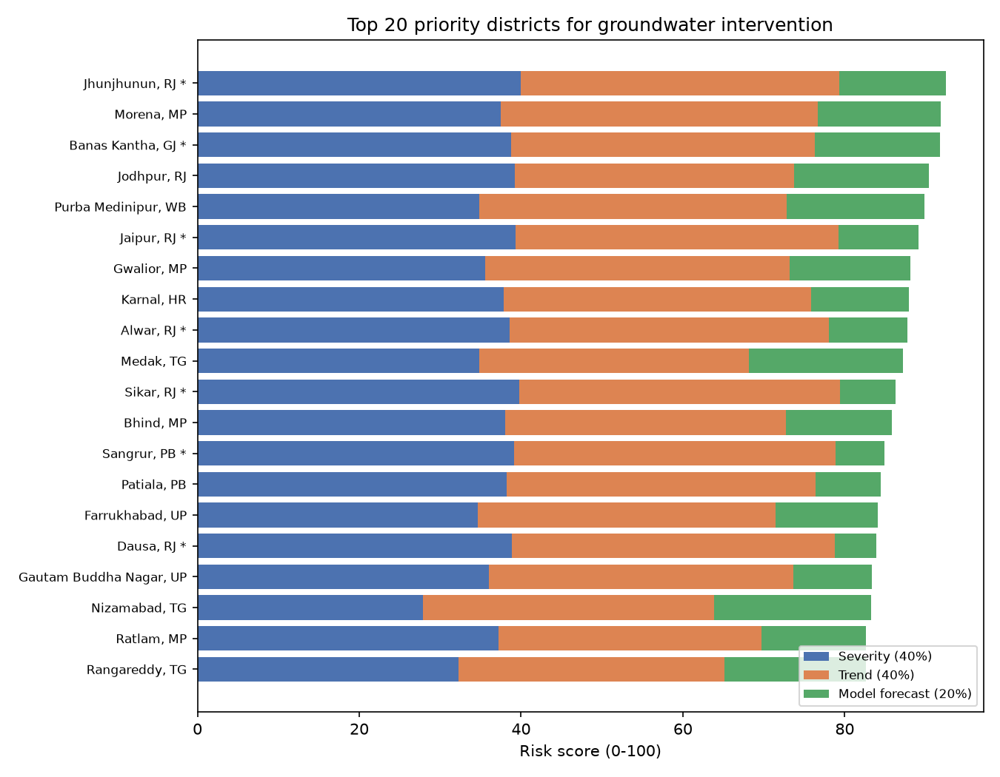
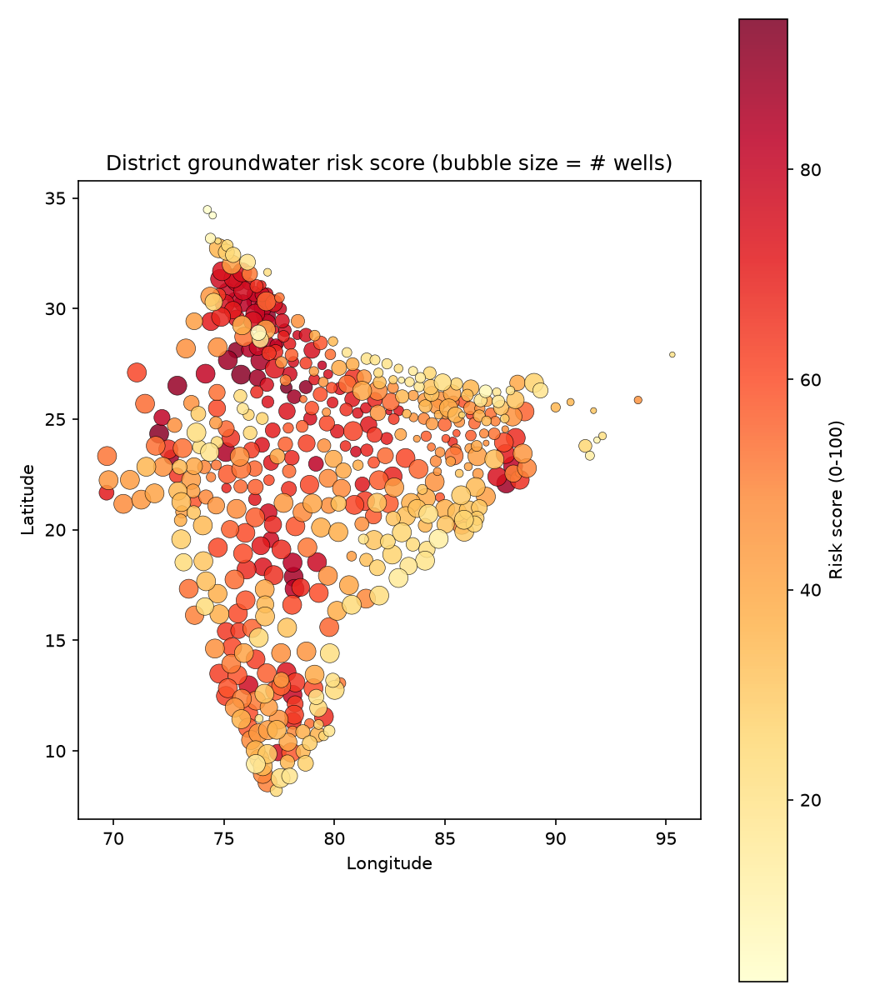

# Groundwater Risk Assessment: District Priority Ranking

**This is a methodology demonstration, not a live assessment.** The underlying CGWB data (`docs/DATA_SOURCES.md`) runs through Jan 2017; this output forecasts one quarter past each well's own last reading, which for most wells lands in the mid-2010s. It shows the pipeline produces a real, usable ranked output from real data -- re-running it against current CGWB/India-WRIS data (`src/data/download_cgwb_data.py`) would make it current.

## Methodology

District risk score = 40% current severity + 40% measured historical trend + 20% model-forecasted next-quarter change (each as a 0-100 percentile rank across 499 districts with at least 5 monitored wells). The weighting is deliberate, not arbitrary: `docs/EXPLAINABILITY.md` found the model is systematically too optimistic and barely uses the trend feature on its own, so this score leans on two directly-measured, model-independent signals (severity, trend) and treats the model's forecast as a smaller, confirming input -- not the primary driver.

**10 districts (marked \*) are ones where `docs/EVALUATION.md`/`docs/EXPLAINABILITY.md` specifically found the model under-predicts severity** -- 7 of them appear in the top 20 below. For these, treat the risk score as a floor, not a ceiling: the real situation is more likely to be *worse* than scored than better.

## Top 20 priority districts

| Rank | State | District | Wells | Current depth (m) | Trend (m/yr) | Risk score | Forecast confidence | Flag |
|---|---|---|---|---|---|---|---|---|
| 1 | RJ | Jhunjhunun | 40 | 53.15 | +0.713 | 92.5 | Low (8.2 m) | \* |
| 2 | MP | Morena | 23 | 15.65 | +0.647 | 91.9 | Low (6.7 m) |  |
| 3 | GJ | Banas Kantha | 120 | 22.05 | +0.307 | 91.7 | Low (8.3 m) | \* |
| 4 | RJ | Jodhpur | 100 | 28.15 | +0.143 | 90.4 | Low (7.2 m) |  |
| 5 | WB | Purba Medinipur | 83 | 11.37 | +0.381 | 89.8 | Low (6.2 m) |  |
| 6 | RJ | Jaipur | 118 | 33.65 | +0.920 | 89.1 | Low (6.8 m) | \* |
| 7 | MP | Gwalior | 32 | 11.65 | +0.310 | 88.1 | Low (6.5 m) |  |
| 8 | HR | Karnal | 125 | 16.75 | +0.437 | 87.9 | Medium (4.1 m) |  |
| 9 | RJ | Alwar | 77 | 21.20 | +0.742 | 87.8 | Low (5.1 m) | \* |
| 10 | TG | Medak | 109 | 11.31 | +0.115 | 87.2 | Low (7.8 m) |  |
| 11 | RJ | Sikar | 70 | 43.23 | +0.790 | 86.3 | Low (6.6 m) | \* |
| 12 | MP | Bhind | 29 | 17.40 | +0.146 | 85.8 | Low (7.1 m) |  |
| 13 | PB | Sangrur | 48 | 27.24 | +0.853 | 84.9 | Low (5.3 m) | \* |
| 14 | PB | Patiala | 67 | 19.13 | +0.473 | 84.4 | Medium (3.9 m) |  |
| 15 | UP | Farrukhabad | 13 | 11.20 | +0.254 | 84.0 | High (2.5 m) |  |
| 16 | RJ | Dausa | 45 | 23.26 | +0.935 | 83.9 | Low (7.0 m) | \* |
| 17 | UP | Gautam Buddha Nagar | 13 | 11.92 | +0.323 | 83.3 | Medium (3.4 m) |  |
| 18 | TG | Nizamabad | 96 | 7.97 | +0.206 | 83.2 | Low (5.7 m) |  |
| 19 | MP | Ratlam | 67 | 15.30 | +0.105 | 82.6 | Low (11.1 m) |  |
| 20 | TG | Rangareddy | 184 | 9.63 | +0.112 | 82.6 | Low (7.2 m) |  |

Full ranking for all 499 qualifying districts: `data/processed/district_risk_scores.csv` (regenerate with `python src/output/risk_score.py`).

### Reading the confidence column

**Forecast confidence** is the width of the model's 80% prediction interval for that district, bucketed into terciles across all districts (`High` = narrowest third). `docs/UNCERTAINTY.md` validates it on the same backtest as the rest of the evaluation: the interval holds the actual reading 77% of the time against a nominal 80%, and its width tracks district-level error closely enough (r = 0.90) to be worth acting on -- districts in the widest quartile are off by 2.71 m on average against 0.81 m in the narrowest.

It is deliberately **not** folded into the risk score. Letting the model's confidence change the weighting district by district would make two districts' scores incomparable, which is the one thing a ranking cannot afford. It sits beside the score instead: 16 of the top 20 carry `Low` confidence, and for those the 20% model-forecast component should be read as the weakest part of the number, with the 80% that comes from directly measured severity and trend carrying the weight.

## Geographic view

Each point is one district (positioned at its wells' average location), sized by how many wells monitor it and colored by risk score. This is the actionable geographic output the project set out to build -- a groundwater board could use this directly to decide where to send a field team first, without needing to read any of the underlying model documentation.

## What this decision-support output can and can't claim

It can support: *prioritizing which districts to examine or intervene in first*, using both current severity and measured trend, cross-checked against a model forecast. It cannot replace: CGWB's official extraction/recharge-based classification (this ranking uses only well-level depth data, not recharge estimates); a real-time assessment (data currency caveat above); or a substitute for field verification, especially in the flagged districts where the model itself is known to run optimistic. This matches the scope set out in `docs/PROBLEM_STATEMENT.md`: a decision-support prototype, not a production regulatory tool.
