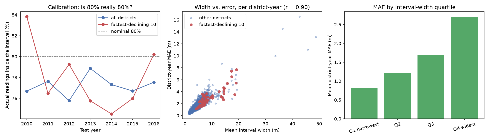

# Prediction intervals: does the model know when to distrust itself?

`docs/EVALUATION.md` found the model wins 73% of district-year checks overall but only 32% in the fastest-declining districts, and `docs/DISTRICT_MODEL.md` ruled out the obvious cause. If the point forecast cannot be made reliable in those districts, the next most useful thing is for it to say so. This fits two extra gradient-boosted models at the 10% and 90% quantiles, giving an 80% prediction interval around every forecast, and asks whether that interval is trustworthy and informative -- on the same 7 walk-forward splits as the rest of the evaluation.

## 1. Is it calibrated?

| Test year | Test n | Coverage (all) | Coverage (worst 10) | Mean width (m) |
|---|---|---|---|---|
| 2010 | 37,462 | 76.7% | 83.8% | 4.37 |
| 2011 | 35,826 | 77.6% | 76.5% | 4.36 |
| 2012 | 26,955 | 75.8% | 79.2% | 4.35 |
| 2013 | 28,013 | 78.9% | 75.8% | 4.46 |
| 2014 | 43,718 | 77.3% | 74.5% | 4.47 |
| 2015 | 51,293 | 76.7% | 76.0% | 4.43 |
| 2016 | 52,494 | 77.5% | 80.2% | 4.50 |
| **overall** | 275,761 | **77.2%** | **78.0%** | **4.43** |

An interval sold as 80% contains the actual reading 77.2% of the time -- slightly over-confident by 2.8 percentage points, close enough to mean roughly what it says, but worth stating in that direction rather than rounding it to 'calibrated'. 
In the fastest-declining districts coverage is 78.0%, which is in line with the overall figure, so the interval does not quietly break down in the districts that matter most.

## 2. Is it wider where the model is worse?

Mean interval width is **9.56 m** in the fastest-declining districts against **4.45 m** elsewhere -- 2.1x wider. The model is visibly less sure in precisely the districts where it is in fact less accurate, which is the behaviour that makes an interval worth showing at all.

## 3. Does width predict error at district level?

Across 2,587 (district, year) cells with at least 30 readings, the correlation between mean interval width and actual MAE is **r = 0.90**. Grouped into width quartiles:

| Width quartile | Cells | Mean width (m) | Mean MAE (m) | Coverage |
|---|---|---|---|---|
| Q1 narrowest | 647 | 2.37 | 0.81 | 78.4% |
| Q2 | 647 | 3.52 | 1.22 | 77.1% |
| Q3 | 646 | 4.72 | 1.68 | 76.8% |
| Q4 widest | 647 | 7.58 | 2.71 | 75.7% |

Forecasts in the widest quartile are off by 2.71 m on average against 0.81 m in the narrowest -- 3.3x. The width is not decoration: it is a usable, ranked signal of how much to trust a given district's forecast, available at prediction time, before the truth is known.

## What this changes

The district-level gap is not closed and this does not close it -- the point forecast in the fastest-declining districts is exactly as good, or as bad, as it was. What changes is that the system no longer has to present every forecast with the same implied confidence. A groundwater board reading the ranking can see which districts the model is guessing at, and weight a wide-interval district toward the directly measured severity and trend signals -- which is already how `src/output/risk_score.py` is weighted, for the same reason.
